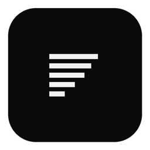
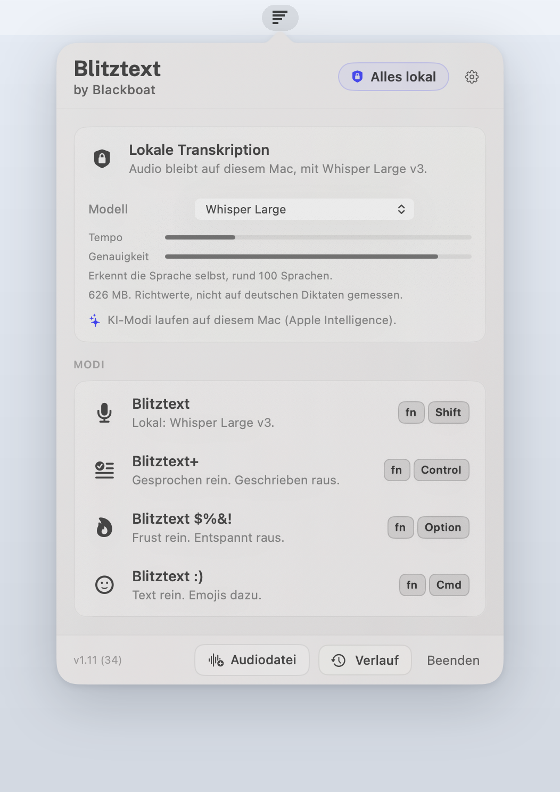
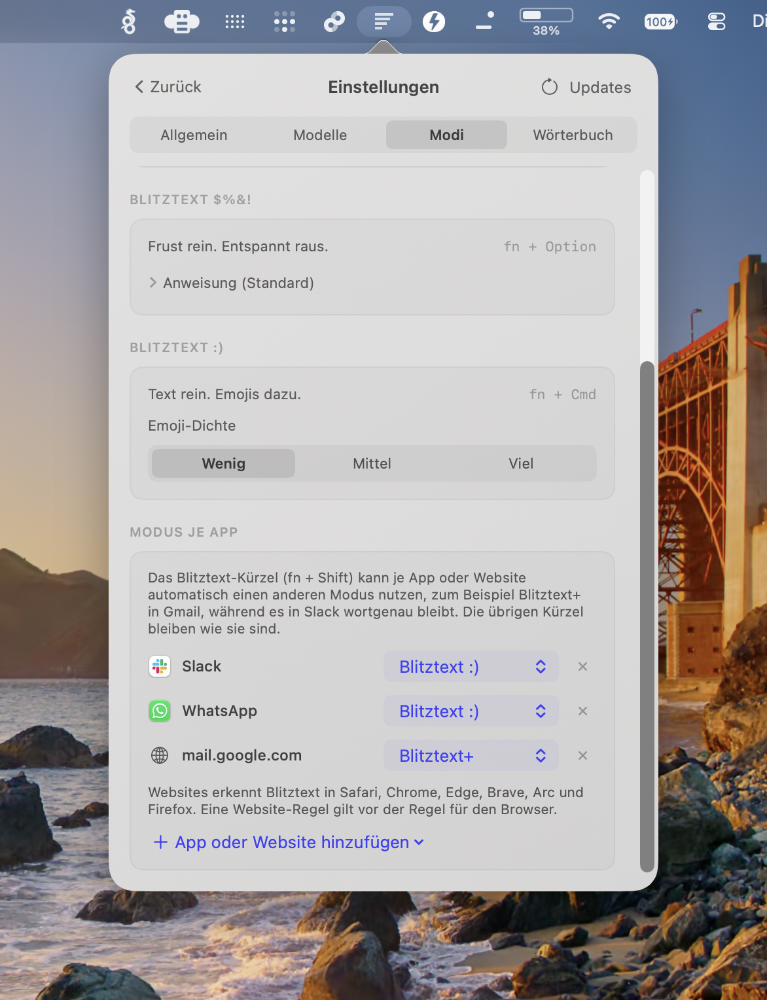
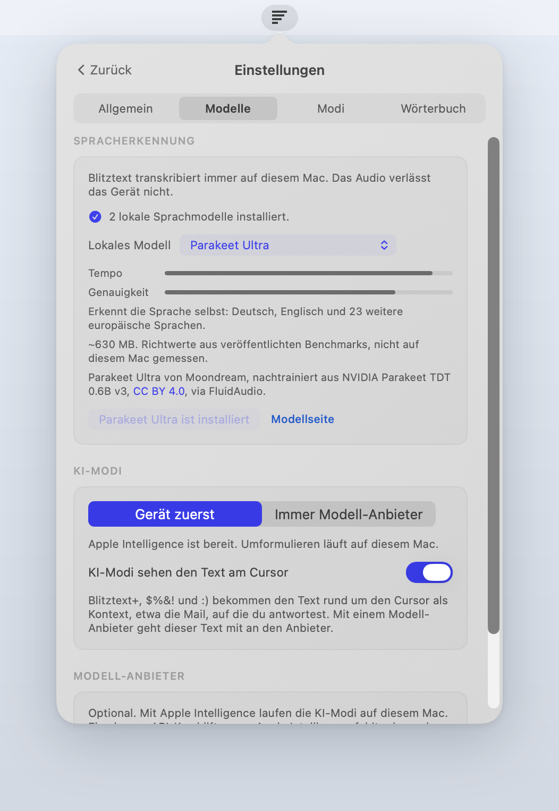
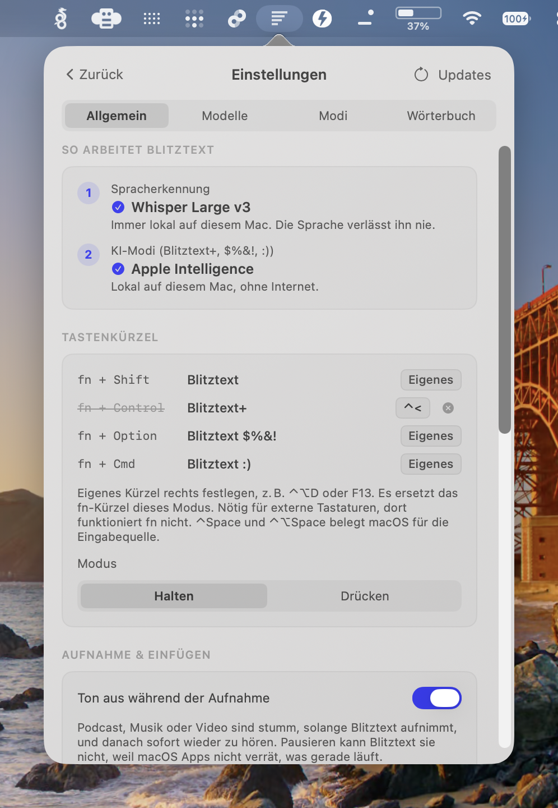

<p align="center">
  
</p>

<h1 align="center">Blitztext</h1>

<p align="center">
  <b>Speak. Text. Done.</b><br>
  Dictation for your Mac that runs entirely on your Mac.
</p>

<p align="center">
  <a href="https://github.com/cmagnussen/blitztext-app/releases/latest"></a>
  
  <a href="LICENSE"></a>
  <a href="https://github.com/cmagnussen/blitztext-app/actions/workflows/ci.yml"></a>
</p>

<p align="center">
  <a href="https://github.com/cmagnussen/blitztext-app/releases/latest"><b>Download for macOS</b></a> ·
  <a href="https://blitztext.de">blitztext.de</a> ·
  <a href="#build-it-yourself">Build it yourself</a>
</p>

<p align="center">
  
  
</p>

Hold a shortcut, speak, let go. Blitztext turns your speech into text and pastes it where your cursor is. Speech recognition runs on your Mac, the writing modes use Apple Intelligence on your Mac. No account, no server, no audio leaving the device.

## Why Blitztext?

- **Private:** your voice never leaves your Mac. No account, no backend, no telemetry.
- **Native:** a small menu bar app in Swift, made for macOS, fast on Apple silicon.
- **More than dictation:** four modes turn rough speech into clean text, a calm message or a message with emojis.
- **Free and open:** MIT licensed. Use it, learn from it, build on it.

## How It Works

1. **Hold** a shortcut, for example `fn + Shift`.
2. **Speak** in any language your model knows. A small lilac pill at the bottom of the screen shows that Blitztext is listening.
3. **Let go.** Blitztext transcribes on your Mac with Parakeet or Whisper.
4. **Done.** The text appears at your cursor, fitted to the text around it. Your clipboard is restored afterwards.

## Modes

| Mode | Shortcut | What happens |
|---|---|---|
| **Blitztext** | `fn + Shift` | Speech to exact text |
| **Blitztext+** | `fn + Control` | Speech to clean written text |
| **Blitztext $%&!** | `fn + Option` | Frustrated speech to a calm, effective message |
| **Blitztext :)** | `fn + Cmd` | Text with fitting emojis |

Keyboards without `fn`: set your own shortcut per mode in the settings.

## Features

- **Local speech recognition:** Parakeet Ultra (fast, 25 European languages) or OpenAI Whisper via WhisperKit (about 100 languages). Both detect the spoken language.
- **Local writing modes:** Blitztext+, $%&! and :) run with Apple Intelligence on your Mac (macOS 26). Optionally bring your own model provider: OpenAI, Anthropic, Google Gemini, Mistral, OpenRouter, or a local server such as Ollama or LM Studio.
- **Fits where you type:** spaces and capitals follow the text around your cursor, also mid-sentence. Password fields are never read.
- **Mode per app or website:** Gmail always Blitztext+, Slack with emojis, everything else word for word.
- **See that it listens:** a small lilac pill at the bottom of the screen moves with your voice while Blitztext records. Click it to stop. It never takes the focus, so the text still lands where you type. You can turn it off in the settings.
- **Last text at hand:** the menu bar window shows your last text as a message. One click copies it.
- **Sound off while recording:** a podcast or music is muted while you speak and back right after.
- **Meetings in the room and online:** record a conversation through the microphone, get the transcript by person (Person 1, Person 2, rename them) and, if you like, a summary with decisions and to-dos. For calls, "Online-Meeting" (beta) also records what your Mac plays, for example from Teams, Zoom or Meet: you are "Ich", the others are told apart by voice, and what your microphone picks up from the speakers is filtered out of your part. Live notes (beta) show topics, decisions and to-dos while the meeting runs. Everything runs on your Mac and the recordings are deleted afterwards. Apple Silicon only. Please ask everyone before you record.
- **Local language model for meetings (beta):** download Gemma 4 in the settings (E4B from 16 GB of memory, 12B from 24 GB). It summarizes long meetings more exactly than Apple Intelligence, on your Mac.
- **Text lands in the right place:** if you click into another field while a writing mode still works, the text goes to the clipboard instead of the wrong field. After a writing mode, "Wortgenau statt ..." in the menu swaps in what you actually said.
- **Voice memos and WhatsApp voice messages:** drop an audio file on Blitztext and get the text, optionally with paragraphs.
- **Dictionary:** names and terms spelled your way, fixed replacements ("n acht n" becomes "n8n").
- **History:** recent results, encrypted and stored only on your Mac.
- **Updates in the app:** Blitztext offers new versions from this repository's releases, signed and notarized by Apple.
- **Feedback:** "Feedback senden" in the settings prepares a mail to the team with version and setup. You see everything before it goes out.

## Screenshots

| | |
|---|---|
|  |  |
| Speech recognition and AI modes on your Mac | How Blitztext works, shortcuts and the lilac pill while you speak |

The app is in German for now.

## Install

1. Open the [latest release](https://github.com/cmagnussen/blitztext-app/releases/latest), download the ZIP under "Assets", unpack it and move **Blitztext.app** to **Applications**.
2. Open Blitztext. It lives in the menu bar.
3. Allow **Microphone** and **Accessibility** (needed to paste into other apps).
4. In the settings (**Modelle**), load a local speech model once. Parakeet Ultra is recommended on Apple silicon, about 630 MB.
5. Hold `fn + Shift`, speak, let go.

**Requirements:** macOS 14 or newer. Parakeet needs Apple silicon; Intel Macs use Whisper. The writing modes on the device need macOS 26 with Apple Intelligence turned on; without it, add your own model provider or use plain dictation.

## Privacy

```text
Speech recognition:  your Mac (Parakeet or Whisper, Core ML / Neural Engine)
Writing modes:       your Mac (Apple Intelligence)
                     or, if you add one, your own model provider with your own API key
Meetings:            your Mac (transcript, speakers, live notes, summary with
                     Apple Intelligence or the optional local model); the summary
                     goes to your own provider only as described in docs/privacy.md
Model download:      Hugging Face, once per model
Update check:        GitHub releases of this repository (can be turned off)
```

Blitztext has no backend and collects no data. Details in [docs/privacy.md](docs/privacy.md).

## Known Limitations

- **`fn` shortcuts** only work on Apple keyboards. Set your own shortcut for other keyboards.
- **Paste stops after an update or a rebuild:** in the settings under Allgemein, click "Freigabe zurücksetzen" and allow Blitztext again. By hand: System Settings > Privacy & Security > Accessibility, remove the old Blitztext entry, add the current app and restart it.
- **First dictation after a macOS update** can take a few minutes while macOS prepares the model for the Neural Engine. Blitztext shows a hint; keep it running.
- **Whisper on silence** sometimes invents phrases like "Thank you." Blitztext filters the known ones.
- **Macs managed with Jamf:** in-app updates are off on the whole Mac, also for a copy you installed yourself. There, your device management handles updates.
- **Online meetings (beta):** without headphones the microphone also hears the speakers. Blitztext filters that echo out of your part; a short scrap can remain. Headphones give the cleanest result. macOS asks for "System Audio Recording" the first time.
- **Local language model (beta):** needs Apple Silicon and at least 16 GB of memory, the 12B model 24 GB. It uses about 5 to 7 GB while it summarizes and frees them afterwards.

More in [docs/setup.md](docs/setup.md) and [docs/local-models.md](docs/local-models.md).

## Build It Yourself

You need Xcode 26 or newer (for the Apple Intelligence APIs) and [XcodeGen](https://github.com/yonaskolb/XcodeGen) (`brew install xcodegen`).

```bash
git clone https://github.com/cmagnussen/blitztext-app.git
cd blitztext-app
./build.sh --install --run
```

`build.sh` creates an ad-hoc signed app for your own Mac. If you publish a fork, use your own bundle identifier, name and icon (see [TRADEMARKS.md](TRADEMARKS.md)) and sign it with your own Developer ID.

```text
BlitztextMac/        macOS menu bar app (SwiftUI, AppKit)
  App/               app state and lifecycle
  Features/          workflows, menu bar, settings, audio files, release notes, recording pill
  Services/          recording, hotkeys, local transcription, paste, history, updates
  Views/             shared UI pieces
  Tests/             unit tests: post-processing, cursor fit, paragraphs, filters
BlitztextShared/     code shared with the (not yet public) iOS app
  AI/                model providers, Apple Intelligence rewriting, mode prompts
  Audio/             audio file conversion
  Transcription/     Whisper call and filter for invented text
  Design/            design tokens, Public Sans, shapes (speech bubble, message, Blackboat mark)
  Licenses/          bundled third-party licenses
build.sh             local build script
```

## Contributing

Contributions are welcome. Please read [CONTRIBUTING.md](CONTRIBUTING.md), and see [ROADMAP.md](ROADMAP.md) for what comes next.

Thanks to everyone whose pull requests shaped this version, among them automatic paragraphs (#21), build fixes (#5, #16) and a cancellation fix (#10).

## From the Community

Independent projects built on the Blitztext idea. They are not maintained or reviewed by Blackboat.

- Linux (KDE/Wayland): [TimInTech/blitztext-linux](https://github.com/TimInTech/blitztext-linux)
- Windows with voice notes: [danielstefanmueller/Blitznotiz](https://github.com/danielstefanmueller/Blitznotiz)
- Windows (.NET 8): [echobrain-de/blitztext](https://github.com/echobrain-de/blitztext)
- Fork with history, meetings and a team server: [mschnitzler-creator/blitztext-app-v2](https://github.com/mschnitzler-creator/blitztext-app-v2)

## Acknowledgments

- **[FluidAudio](https://github.com/FluidInference/FluidAudio)**, **Moondream** and **NVIDIA** for Parakeet Ultra on Core ML
- **[WhisperKit](https://github.com/argmaxinc/argmax-oss-swift)** by Argmax and **OpenAI** for Whisper
- **[Sparkle](https://sparkle-project.org)** for updates
- **Google** for Gemma 4 and **[MLX](https://github.com/ml-explore/mlx-swift)** for running it on the Mac
- **Community contributors** who send fixes and ideas
- **The open-source dictation community**, whose work inspired parts of Blitztext

Full license texts: [THIRD_PARTY_NOTICES.md](THIRD_PARTY_NOTICES.md), also inside the app (Settings > Allgemein > Über Blitztext).

## License

MIT License, see [LICENSE](LICENSE). Free and open source, built and maintained by Blackboat alongside our client work, without warranty and without guaranteed support.

The Blitztext name, logo, icon and brand assets are not open source. Forks and redistributions must use their own branding and must not imply endorsement by Blackboat, see [TRADEMARKS.md](TRADEMARKS.md).

## Legal / Impressum & Datenschutz

The signed release builds and the website blitztext.de are published by Blackboat Internet GmbH.

- Impressum: https://www.blackboat.com/impressum
- Datenschutz / Privacy: https://www.blackboat.com/datenschutz
